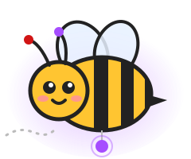
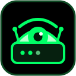
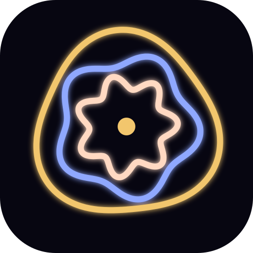
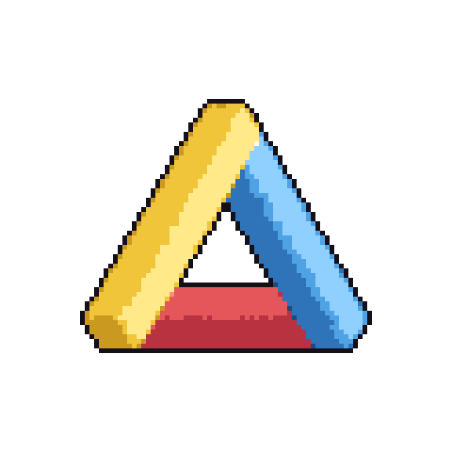
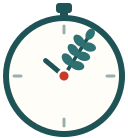

<div align="center">

# Ola! I'm alex quiterio ☘️

**Staff engineer @ [Seenons](https://seenons.com/en) · AI engineering · distributed systems · climate tech**

<a href="https://github.com/alex-quiterio">
  
</a>


</div>

---

### 🛰️ Mission control

```yaml
base:  Amsterdam · building since 2011
now:   Staff engineer @ Seenons · AI factories, event-driven systems
fuel:  curiosity, hand-rolled protocols, and active hope 🌿
```

### 🏆 What I do

- **AI engineering and AI factories.** I build with AI every day and design the factory around it: agents and skills wired into real workflows, with the guardrails, review loops and tests that make AI-produced software something you can ship.
- **Distributed systems from the metal up.** A full blockchain node, a compiler, a Lisp interpreter, Go-style channels in safe Rust.
- **Product engineering that respects people.** Local-first, privacy-preserving apps where the data stays on your device.
- **Growing engineers and teams.** Pairing, reviews, architecture workshops.

### 🚀 Flight log

Public repositories, by kind (tap a group to open it). Live demos are linked where there is one.

<details>
<summary><b>🤖 AI engineering</b></summary>

| Repo | Stack | What it is |
| --- | --- | --- |
|  **baikonur** 🔒 | TypeScript · Temporal | A personal AI factory: label a GitHub issue and an agent crew triages it, writes a plan for human review, then implements, validates and opens a draft PR. Credential-less agents, durable workflows, a per-token cost ledger. |
|  **buchecha** 🔒 | Python | My Claude Code marketplace: 8 plugins and 36 skills, with zero dependencies. |
|  [**hearth**](https://github.com/alex-quiterio/hearth) | TypeScript · Claude | A local dashboard with Claude in a side panel running the same agent skills as the terminal. |

*🔒 private repository.*

</details>

<details>
<summary><b>⛓️ Distributed systems and ledgers</b></summary>

| Repo | Stack | What it is |
| --- | --- | --- |
|  [**blockchain-rs**](https://github.com/alex-quiterio/blockchain-rs) | Rust | A small, readable cryptocurrency: proof of work *and* stake, RANDAO beacons, stand-in validators, gossiping peers, and a web UI that explains every block. |
|  [**byzantine-quorums**](https://github.com/alex-quiterio/byzantine-quorums) | Java | Quorum replication that keeps serving correctly while some servers lie. |
|  [**chann**](https://github.com/alex-quiterio/chann) | Rust | Go-style multi-producer, multi-consumer channels with a real `select`, no `unsafe`. |
|  [**blockchain-transactions-rs**](https://github.com/alex-quiterio/blockchain-transactions-rs) | Rust | Accounts and transactions API on axum, sqlx and PostgreSQL. |
|  [**message-broker.rb**](https://github.com/alex-quiterio/message-broker.rb) | Ruby | A message broker on a Kafka backend. |

</details>

<details>
<summary><b>λ Languages, runtimes and tooling</b></summary>

| Repo | Stack | What it is |
| --- | --- | --- |
|  [**At-Compiler**](https://github.com/alex-quiterio/At-Compiler) | C++ | A compiler for a tiny symbolic language targeting 32-bit x86. |
|  [**ttinylisp**](https://github.com/alex-quiterio/ttinylisp) | JavaScript | A Lisp interpreter small enough to read in one sitting. |
|  [**check-assertions**](https://github.com/alex-quiterio/check-assertions) | Java | Runtime-checked `@Assertion` annotations injected at class-load time. |
|  [**playgrounds**](https://github.com/alex-quiterio/playgrounds) | C · Go · Ruby · Prolog · Lisp | Algorithm and language exercises, each with its own tests. |
|  [**repomate**](https://github.com/alex-quiterio/repomate) | Ruby | Keeps a fleet of git repositories in sync from one command. |

</details>

<details>
<summary><b>🛰️ Privacy, signals and simulation</b></summary>

| Repo | Stack | What it is |
| --- | --- | --- |
|  [**beeline**](https://github.com/alex-quiterio/beeline) | Rust | Autonomous drone simulator: A* planning, bee-inspired optic-flow navigation, PX4-style collision prevention. |
|  [**peekaboo**](https://github.com/alex-quiterio/peekaboo) | Rust · TypeScript | Read-only, privacy-conscious home network audit. |
|  [**rusty-diary**](https://github.com/alex-quiterio/rusty-diary) | Rust | A diary application for securely recording daily entries. |
|  [**lock-guard**](https://github.com/alex-quiterio/lock-guard) | Swift | Tells you if someone touched your Mac while the screen was locked. |
|  [**precog-trend-radar**](https://github.com/alex-quiterio/precog-trend-radar) | TypeScript | A morning brief of world attention trends. Tracks topics, never people. |
|  [**oikos**](https://alex-quiterio.github.io/oikos/) | TypeScript | Explorable maps of energy, nutrient and seed flows through eleven ecosystems, with unknowns marked. |
|  [**cybernetics-field-guide**](https://github.com/alex-quiterio/cybernetics-field-guide) | HTML | Interactive field guide to cybernetics with working models. |

</details>

<details>
<summary><b>🌗 Self, reflection and small delights</b></summary>

| Repo | Stack | What it is |
| --- | --- | --- |
|  [**mood-tracker**](https://alex-quiterio.github.io/mood-tracker/) | Expo · React Native | A private mood journal; each week becomes a reflection prompt for Claude. Data never leaves the device. |
|  [**daily-sky-wheel**](https://alex-quiterio.github.io/daily-sky-wheel/) | TypeScript | Daily astrology chart wheel in the browser. |
|  [**gatecast**](https://alex-quiterio.github.io/gatecast/) | TypeScript | Cast a Human Design chart in your browser. Nothing leaves your device. |
|  [**gratitude-trail**](https://gratitude-trail-vercel.vercel.app) | HTML | A physical gratitude card with a QR code and an append-only timeline. |
|  [**garden**](https://github.com/alex-quiterio/garden) | TypeScript | A pixel-art garden that follows the sky over Amsterdam: my personal site. |
|  [**wayfarers-atlas**](https://alex-quiterio.github.io/wayfarers-atlas/) | CSS | An interactive map of a notebook, installable as an app. |
|  [**murmuration**](https://github.com/alex-quiterio/murmuration) | TypeScript | Starling flocks as boids with topological neighbours. |
|  [**loopfield**](https://github.com/alex-quiterio/loopfield) | JavaScript | Electronic music as code: nine songs in Strudel. |
|  [**pixel-dino-splats**](https://github.com/alex-quiterio/pixel-dino-splats) | TypeScript | A pixel-art dinosaur made of 3D gaussian splats. |
|  [**thyme-after-thyme**](https://github.com/alex-quiterio/thyme-after-thyme) | TypeScript | A kitchen timer with proper kitchen sounds. |

</details>

### 🔭 Next orbit

Where I am heading, in rough order of how soon.

- **Now: AI factories.** Making agent-written software trustworthy: plan review gates, credential-isolated agents, per-token cost accounting, durable workflows. This is the day job's frontier and the thread behind Baikonur and hearth.
- **Next: consensus and distributed systems, deeper.** More of blockchain-rs's hard parts (adversarial networks, sync under partition) and a closer look at Byzantine quorums in practice.
- **Next: autonomy.** Beeline grows from a simulator toward real flight dynamics, state estimation and learned policies, with a PX4 bridge as the long-term goal.
- **Always: local-first, privacy-first apps.** More tools that keep your data on your device and track topics, never people.
- **Always: climate and the commons.** Software that leaves a measurable mark on the world: circular economy at work, ecosystem and energy-flow explorers on the side.

### 🧰 Flight systems

<p>
  
  
  
  
  
  
  
  
  
  
  
  
</p>

### 📡 Telemetry

<div align="center">



</div>

### 📻 Open a channel

- 📫 **Personal:** [alexandre@pm.me](mailto:alexandre@pm.me)
- 🛠️ **Work:** [alexandre@seenons.com](mailto:alexandre@seenons.com)
- ✍️ **Transmissions:** [writing on Medium](https://medium.com/@arielquixote)

<div align="center">

<sub>🌍 Ground control to whoever's reading: thanks for stopping by. Keep wondering. ✦</sub>

</div>
